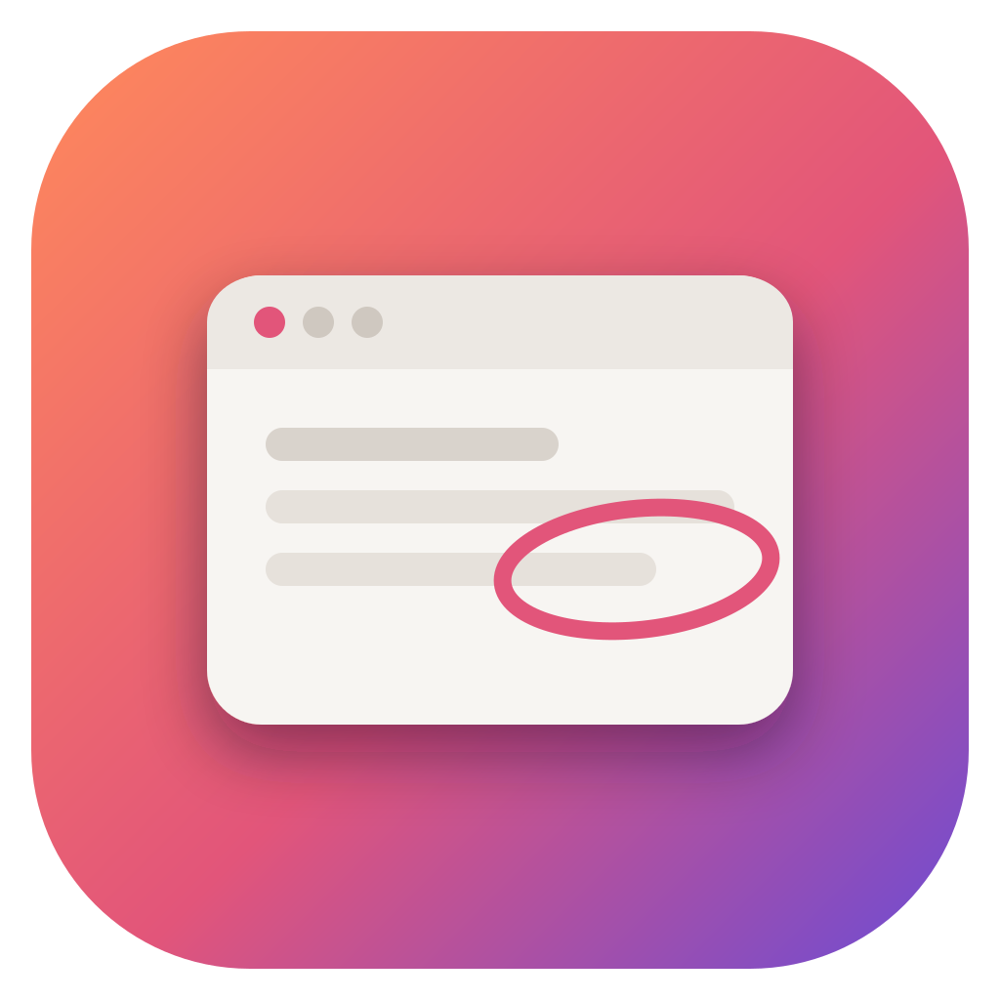
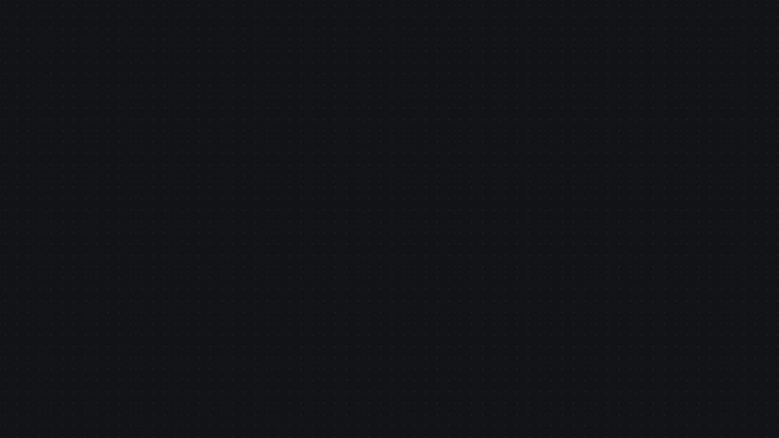
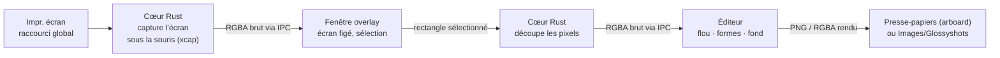

<div align="center">



# Glossyshots

**Des captures d'écran soignées, sans effort.**
Appuyez sur <kbd>Impr. écran</kbd>, sélectionnez une zone, floutez ce qui est privé, entourez ou agrandissez ce qui compte.
Glossyshots pose votre capture sur un fond élégant, prête à coller.

[Télécharger](https://github.com/abg5f/glossyshots/releases/latest) · [Voir la démo (40 s)](docs/media/glossyshots-demo-fr.mp4) · [English](README.md) · [Fonctionnement](#fonctionnement) · [Compiler](#compiler-depuis-les-sources)



</div>

---

## Pourquoi Glossyshots

Une capture brute vous suffit, mais elle passe mal chez les autres : bords de fenêtre coupés net, aucune respiration, informations privées laissées en clair. D'habitude, il faut trois logiciels pour corriger ça, ou un logiciel payant.

Glossyshots fait tout d'un seul geste, en cinq secondes environ :

| | |
|---|---|
| **Une touche** | <kbd>Impr. écran</kbd> fige l'écran. Glissez sur une zone, relâchez, c'est tout. |
| **Confidentiel par conception** | Floutez e-mails, noms ou jetons avant que quoi que ce soit ne quitte votre poste. Le flou ne réutilise jamais les pixels cachés (voir [Flou sécurisé](#flou-sécurisé)) : il n'y a rien à « déflouter ». |
| **Mettre en avant** | La loupe soulève une zone au-dessus de la capture avec une ombre douce. Agrandissez-la, déplacez-la, assombrissez ou floutez le reste. |
| **Montrer du doigt** | Cercles, rectangles et flèches qui restent modifiables : déplacer, redimensionner, changer de couleur. |
| **Joli par défaut** | La capture arrive sur un fond avec marge, coins arrondis et ombre douce. 8 fonds d'écran générés, 10 dégradés ou votre propre dégradé. |
| **Rapide et léger** | Cœur natif en Rust, installeur d'environ 3 Mo, ouverture instantanée. Pas d'Electron. |
| **À vous** | Gratuit et open source (MIT). Pas de compte, pas de cloud, pas de télémétrie. Rien n'est envoyé nulle part. |
| **Bilingue** | Français et anglais, modifiable à tout moment. |

### Face aux outils habituels

| | Outil Capture de Windows | ShareX | CleanShot X | **Glossyshots** |
|---|:---:|:---:|:---:|:---:|
| Prix | Gratuit | Gratuit | Payant | **Gratuit** |
| Open source | Non | Oui | Non | **Oui (MIT)** |
| Windows | Oui | Oui | Non | **Oui** |
| macOS | Non | Non | Oui | **Oui** |
| Flou | Non | Oui | Oui | **Oui, sans contenu** |
| Loupe / mise en avant | Non | Partiel | Oui | **Oui** |
| Fond, marge et ombre en un clic | Non | Via la configuration des effets | Oui | **Oui, appliqués automatiquement** |
| Prise en main | Facile | Exigeante | Facile | **Facile** |

## Fonctionnalités

- **Capture de zone** sur l'écran où se trouve la souris, avec loupe au pixel et dimensions en direct. <kbd>Espace</kbd> capture l'écran entier, <kbd>Échap</kbd> annule.
- **Flou sécurisé** (<kbd>B</kbd>) : masque n'importe quelle zone sans jamais réutiliser ses pixels.
- **Loupe** (<kbd>M</kbd>) : entourez une zone pour la soulever avec une ombre. Déplacez la vue agrandie où vous voulez, redimensionnez-la par ses coins ou à la molette (100 à 400 %), et choisissez si le reste de l'image reste normal, assombri ou flouté.
- **Annotations** : cercle (<kbd>O</kbd>), rectangle (<kbd>R</kbd>), flèche (<kbd>A</kbd>). Maintenez <kbd>Maj</kbd> pour un cercle ou un carré parfait et des flèches à 45°.
- **Fonds** : fonds d'écran, dégradés, dégradé personnalisé ou aucun fond. Curseurs de marge, d'arrondi et d'ombre. Le dernier réglage est mémorisé.
- **Copie automatique** : chaque capture arrive dans le presse-papiers, fond compris, dès qu'elle est prise. Désactivable dans les Réglages si vous préférez copier vous-même.
- **Sortie** : <kbd>Ctrl</kbd>+<kbd>C</kbd> copie l'image en pleine résolution, <kbd>Ctrl</kbd>+<kbd>S</kbd> enregistre un PNG dans `Images/Glossyshots`.
- **Annuler / rétablir** (<kbd>Ctrl</kbd>+<kbd>Z</kbd> / <kbd>Ctrl</kbd>+<kbd>Y</kbd>), sélection et déplacement (<kbd>V</kbd>), suppression (<kbd>Suppr</kbd>).
- Réside dans la **zone de notification**, **lancement au démarrage** en option.

## Installation

Téléchargez le dernier installeur depuis les [Releases](https://github.com/abg5f/glossyshots/releases/latest) :

- **Windows 10/11** : `Glossyshots_x.y.z_x64-setup.exe` (installation pour l'utilisateur, sans droits administrateur)
- **macOS 11+** : `Glossyshots_x.y.z_aarch64.dmg` (Apple Silicon) ou `_x64.dmg` (Intel)

> Les versions ne sont pas encore signées. Windows SmartScreen peut afficher « Éditeur inconnu » : cliquez sur **Informations complémentaires → Exécuter quand même**. Sur macOS, faites un clic droit sur l'app puis **Ouvrir** la première fois, et autorisez l'**Enregistrement de l'écran** dans les Réglages Système.

### Faire ouvrir Glossyshots par <kbd>Impr. écran</kbd> (Windows)

Windows 11 réserve <kbd>Impr. écran</kbd> à son Outil Capture. Glossyshots récupère la touche en un clic : ouvrez les **Réglages** (en haut à droite) et activez **Impr. écran lance Glossyshots**.

Cela modifie un seul réglage propre à votre session (`HKCU\Control Panel\Keyboard\PrintScreenKeyForSnippingEnabled`), le même interrupteur que *Paramètres Windows → Accessibilité → Clavier*. Désactivez-le pour rendre la touche. Si l'Outil Capture s'ouvre encore, fermez puis rouvrez votre session une fois.

Le raccourci de secours <kbd>Ctrl</kbd>+<kbd>Maj</kbd>+<kbd>X</kbd> fonctionne toujours (<kbd>⌘</kbd>+<kbd>Maj</kbd>+<kbd>2</kbd> sur macOS).

## Fonctionnement



1. **Capture.** Le raccourci global réveille le cœur Rust, qui capture l'écran sous la souris avec [`xcap`](https://github.com/nashaofu/xcap) et garde les pixels en mémoire. Rien n'est écrit sur le disque.
2. **Sélection.** Une fenêtre sans bordure, toujours au premier plan, affiche l'écran figé. Créée dès le démarrage, elle ne s'affiche qu'une fois l'image peinte : apparition instantanée, sans flash. Les pixels transitent en binaire brut par l'IPC de Tauri, jamais en base64.
3. **Découpe.** La sélection, convertie en pixels physiques pour rester exacte sur les écrans HiDPI, est découpée en natif.
4. **Édition.** L'éditeur dessine tout sur un seul canvas et met en cache les calques coûteux (zones floutées, fond adouci) : le glisser reste à 60 i/s même sur une capture 4K. Les fonds sont générés par le code (dégradés maillés et linéaires) : aucune image embarquée, nets à toute taille.
5. **Export.** La fonction qui dessine l'aperçu produit aussi l'image en pleine résolution : ce que vous voyez est exactement ce que vous collez.

### Flou sécurisé

Les flous classiques (gaussien, réduction, pixelisation) calculent chaque pixel masqué à partir des pixels qu'ils cachent. C'est ce qui les rend attaquables : déconvolution, comparaison avec des rendus de texte connus, modèles d'IA de « défloutage ».

Glossyshots ne lit jamais les pixels situés dans une zone floutée. Le remplissage est construit uniquement à partir :

1. d'une fine bande de pixels juste **à l'extérieur** du rectangle, interpolée sur toute la surface (patch de Coons) pour se fondre dans l'image ;
2. de fausses lignes de texte très floues, tirées au hasard (graine = identifiant de l'annotation), sans lien avec le contenu réel ;
3. d'un léger grain.

L'image exportée ne contient donc aucune information sur ce qui a été caché. La loupe et son arrière-plan flouté sont rendus à partir de l'image déjà masquée : ils ne peuvent pas non plus révéler une zone cachée.

L'arborescence du projet et la stack technique sont détaillées dans le [README anglais](README.md#project-layout).

## Stack technique

Tauri 2 · Rust (xcap, arboard) · TypeScript + Vite sans framework · Canvas 2D · tokens de design OKLCH · Remotion pour la vidéo de démonstration.

## Compiler depuis les sources

Prérequis : [Node.js 20+](https://nodejs.org), [Rust](https://rustup.rs) et les [prérequis Tauri](https://tauri.app/start/prerequisites/) de votre système (sous Windows : Visual Studio Build Tools avec la charge de travail **Développement Desktop en C++**).

```bash
git clone https://github.com/abg5f/glossyshots.git
cd glossyshots
npm install
npm run app:dev      # lancement avec rechargement à chaud
npm run app:build    # installeurs dans src-tauri/target/release/bundle
```

> Sous Windows, lancez Cargo depuis PowerShell ou cmd : Git Bash fournit sa propre commande `link`, qui masque l'éditeur de liens MSVC.

## Confidentialité

Glossyshots fonctionne entièrement hors ligne : aucun code réseau, aucune statistique, aucun compte. Les captures restent en mémoire jusqu'à ce que vous les copiiez ou les enregistriez.

## Licence

[MIT](LICENSE) © abg5f
