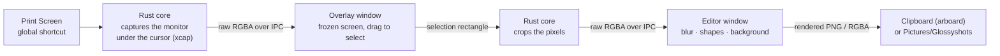

<div align="center">


# Glossyshots

**Screenshots that look good by default.**
Press <kbd>Print Screen</kbd>, select an area, blur what's private, circle or magnify what matters.
Glossyshots sets your capture on a clean background, ready to paste.

[Download](https://github.com/abg5f/glossyshots/releases/latest) · [Watch the demo (40 s)](docs/media/glossyshots-demo.mp4) · [Français](README.fr.md) · [How it works](#how-it-works) · [Build from source](#build-from-source)


</div>

---

## Why Glossyshots

Raw screenshots are fine for you and harsh for everyone else. Sharp window edges, no breathing room, private details left in plain sight. The fix usually means three apps, or a paid one.

Glossyshots does the whole job in one pass, in about five seconds:

| | |
|---|---|
| **One key** | <kbd>Print Screen</kbd> opens a frozen view of your screen. Drag an area, release, done. |
| **Private by design** | Blur emails, names, tokens before anything leaves your machine. The blur never reuses the hidden pixels (see [Secure blur](#secure-blur)), so there is nothing to "unblur". |
| **Make it pop** | The magnifier lifts any area above the capture with a soft shadow. Zoom it, drag it elsewhere, dim or blur the rest. |
| **Point at things** | Circles, rectangles and arrows that stay editable: move them, resize them, recolor them. |
| **Beautiful by default** | Your capture lands on a background with padding, rounded corners and a soft shadow. 8 generated wallpapers, 10 gradients, or your own two-color gradient. |
| **Fast and light** | Native Rust core, ~3 MB installer, opens in a blink. No Electron. |
| **Yours** | Free and open source (MIT). No account, no cloud, no telemetry. Nothing is sent anywhere. |
| **Bilingual** | English and French, switchable at any time. |

### Compared with what you probably use today

| | Windows Snipping Tool | ShareX | CleanShot X | **Glossyshots** |
|---|:---:|:---:|:---:|:---:|
| Price | Free | Free | Paid | **Free** |
| Open source | No | Yes | No | **Yes (MIT)** |
| Windows | Yes | Yes | No | **Yes** |
| macOS | No | No | Yes | **Yes** |
| Blur | No | Yes | Yes | **Yes, content-free** |
| Magnifier / spotlight | No | Partial | Yes | **Yes** |
| One-click background, padding, shadow | No | Via image effects setup | Yes | **Yes, applied automatically** |
| Learning curve | Low | High | Low | **Low** |

## Features

- **Region capture** on the monitor under your cursor, with a pixel loupe and live dimensions. <kbd>Space</kbd> captures the full screen, <kbd>Esc</kbd> cancels.
- **Secure blur** (<kbd>B</kbd>): hides any area without ever reusing its pixels.
- **Magnifier** (<kbd>M</kbd>): draw around an area to lift it with a shadow. Drag the zoomed view anywhere, resize it from its corners or with the mouse wheel (100 to 400 %), and choose whether the rest of the image stays normal, dimmed or blurred.
- **Annotations**: circle (<kbd>O</kbd>), rectangle (<kbd>R</kbd>), arrow (<kbd>A</kbd>). Hold <kbd>Shift</kbd> for perfect circles, squares and 45° arrows.
- **Backgrounds**: wallpapers, gradients, custom gradient, or none. Padding, corner radius and shadow sliders. Your last look is remembered.
- **Output**: <kbd>Ctrl</kbd>+<kbd>C</kbd> copies the full-resolution image, <kbd>Ctrl</kbd>+<kbd>S</kbd> saves a PNG to `Pictures/Glossyshots`.
- **Undo / redo** (<kbd>Ctrl</kbd>+<kbd>Z</kbd> / <kbd>Ctrl</kbd>+<kbd>Y</kbd>), select and move (<kbd>V</kbd>), delete (<kbd>Del</kbd>).
- Lives in the **notification area**, optional **launch at startup**.

## Install

Grab the latest installer from [Releases](https://github.com/abg5f/glossyshots/releases/latest):

- **Windows 10/11**: `Glossyshots_x.y.z_x64-setup.exe` (per-user install, no admin rights needed)
- **macOS 11+**: `Glossyshots_x.y.z_aarch64.dmg` (Apple Silicon) or `_x64.dmg` (Intel)

> Builds are not code-signed yet. Windows SmartScreen may show "Unknown publisher": click **More info → Run anyway**. On macOS, right-click the app and choose **Open** the first time, then allow **Screen Recording** in System Settings.

### Make <kbd>Print Screen</kbd> open Glossyshots (Windows)

Windows 11 reserves <kbd>Print Screen</kbd> for its own Snipping Tool. Glossyshots can hand the key over in one click: open **Settings** (top-right) and turn on **Print Screen opens Glossyshots**.

This flips a single per-user setting (`HKCU\Control Panel\Keyboard\PrintScreenKeyForSnippingEnabled`), the same switch as *Windows Settings → Accessibility → Keyboard*. Turn it off to give the key back. If the Snipping Tool still opens, sign out and back in once.

The fallback shortcut <kbd>Ctrl</kbd>+<kbd>Shift</kbd>+<kbd>X</kbd> always works (<kbd>⌘</kbd>+<kbd>Shift</kbd>+<kbd>2</kbd> on macOS).

## How it works



1. **Capture.** A global shortcut wakes the Rust core, which grabs the monitor under the cursor with [`xcap`](https://github.com/nashaofu/xcap) and keeps the pixels in memory. Nothing is written to disk.
2. **Select.** A borderless, always-on-top window shows the frozen screen. It is pre-created at startup and only paints once the image is ready, so it appears instantly with no flash. Pixels travel as raw binary over Tauri's IPC, never as base64.
3. **Crop.** Your selection (converted to physical pixels, so it stays exact on HiDPI screens) is cropped natively.
4. **Edit.** The editor draws everything on a single canvas, and caches the expensive layers (blur patches, softened background), which keeps dragging at 60 fps even on 4K captures. Backgrounds are generated in code (mesh and linear gradients): no bundled images, sharp at any size.
5. **Export.** The same render function that draws the preview renders the full-resolution output, so what you see is exactly what you paste.

### Secure blur

Classic blurs (gaussian, downscale, pixelate) compute every hidden pixel from the pixels they hide. That is what makes them attackable: deconvolution, matching against known text renderings, or AI "unblur" models can recover the original.

Glossyshots never reads the pixels inside a blurred area. The patch is built only from:

1. a thin band of pixels just **outside** the rectangle, smoothly interpolated across it (a Coons patch), so it blends with the surroundings;
2. fake, heavily blurred "text lines" drawn at random, seeded by the annotation id, unrelated to the real content;
3. a fine grain.

The exported image therefore contains no information about what was hidden. The magnifier and its blurred backdrop are rendered from the already-redacted image, so they cannot leak a hidden area either.

### Project layout

```
src-tauri/            Rust core (Tauri 2)
  src/lib.rs          capture → crop → clipboard / file, window orchestration
  src/shortcut.rs     global shortcuts (Print Screen + fallback)
  src/settings.rs     language, Print Screen hand-over, launch at startup
  src/tray.rs         notification-area icon and menu
src/
  overlay/            region selection (frozen screen, loupe, dimensions)
  editor/             editor UI, render pipeline, generated backgrounds
  lib/                i18n (en/fr), IPC helpers, icons
  styles/             design tokens (OKLCH), overlay and editor styles
video/                Remotion project for the demo video
```

## Tech stack

| Layer | Choice | Why |
|---|---|---|
| App shell | [Tauri 2](https://tauri.app) | Native window, tray and shortcuts with the system webview: small binary, low memory |
| Core | Rust | Screen capture, cropping, clipboard and file IO off the UI thread |
| Capture | [`xcap`](https://crates.io/crates/xcap) | Cross-platform monitor capture |
| Clipboard | [`arboard`](https://crates.io/crates/arboard) | Image clipboard on Windows and macOS |
| UI | TypeScript + Vite, no framework | ~50 KB of JS, Canvas 2D rendering, instant startup |
| Design | OKLCH tokens, system fonts | Native feel on each OS, consistent contrast |
| Demo video | [Remotion](https://www.remotion.dev) | Motion design written in React, rendered to MP4/GIF |

## Build from source

Prerequisites: [Node.js 20+](https://nodejs.org), [Rust](https://rustup.rs), and the [Tauri prerequisites](https://tauri.app/start/prerequisites/) for your OS (on Windows: Visual Studio Build Tools with the **Desktop development with C++** workload).

```bash
git clone https://github.com/abg5f/glossyshots.git
cd glossyshots
npm install
npm run app:dev      # run with hot reload
npm run app:build    # build installers into src-tauri/target/release/bundle
```

> On Windows, run Cargo from PowerShell or cmd. Git Bash ships its own `link` command, which shadows the MSVC linker.

## Privacy

Glossyshots works fully offline. It has no network code, no analytics and no account. Captures stay in memory until you copy or save them.

## Roadmap

- [ ] Text annotations and numbered steps
- [ ] Window detection (click a window to capture it)
- [ ] Capture history
- [ ] Your current wallpaper or any image as background
- [ ] Aspect-ratio presets for social posts
- [ ] Signed builds

## Contributing

Issues and pull requests are welcome. Please keep the UI quiet (one accent color, system fonts) and run `npm run build` and `cargo clippy` before opening a PR.

## License

[MIT](LICENSE) © abg5f
